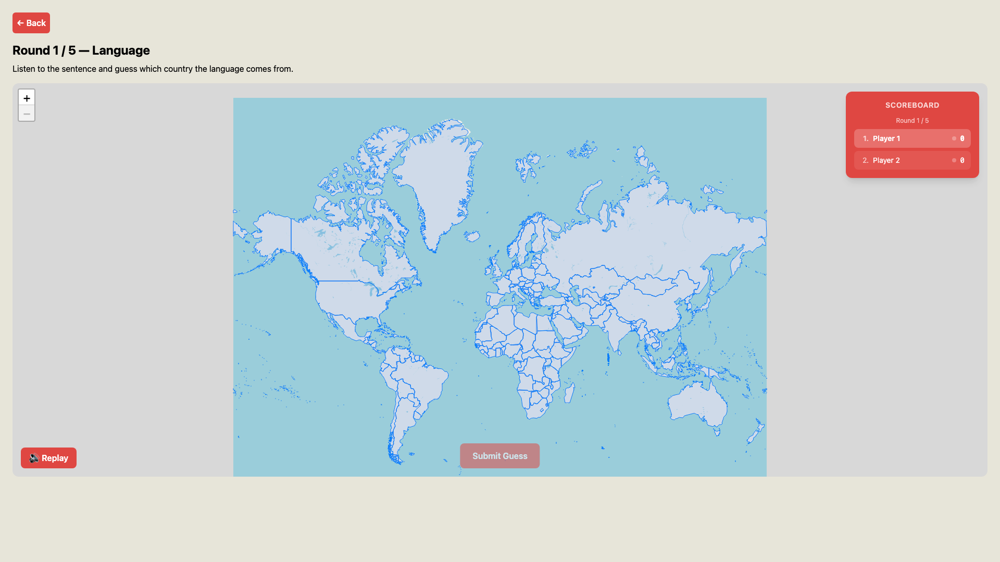

#  AccentGuessr - [Live Site](https://accent-guessr.vercel.app/)
## About
AccentGuessr is a game that allows the player to guess where different languages & accents are from. There are two primary gamemodes:
- **Accents**: Players listen to a real person read a short English passage and then guess the country where the speaker grew up.
- **Language**: Players listen to a full sentence spoken in a foreign language and are tasked with identifying the location of origin.

Players can enjoy AccentGuessr in both singleplayer mode and multiplayer mode.



Accents mode uses recordings of real speakers from more than 140 countries, taken from the [Speech Accent Archive](https://accent.gmu.edu). Language mode uses sentences translated with Google Cloud Translation and voiced with Google's natural-sounding Text-to-Speech voices. All clips are generated ahead of time and served as static files, so playing the game doesn't call any paid API.

This application is deployed with [Vercel](https://vercel.com/) and can be accessed via the link [here](https://accent-guessr.vercel.app/).

## Setup
### Backend
In `backend/`, run the following:
```
cd backend && npm install
npm run dev
```
The server needs no environment variables. It serves the pre-generated clips in `backend/public/clips`, listed in `backend/clips/manifest.json`.

#### Regenerating the audio clips
- **Accents**: `npm run clips:accents` downloads each speaker in `clips/accent-speakers.json` from the archive, cuts out the last two sentences of the paragraph they read ("We also need a small plastic snake… train station", which doesn't mention anyone by name) and evens out the volume. Requires [ffmpeg](https://ffmpeg.org/). Edit `accent-speakers.json` to add or remove speakers (`file` is the archive's file name, `country` is the Alpha-3 code). `start` and `end` mark where those sentences are in the recording; for new speakers without them, the script finds them with [Whisper](https://github.com/openai/whisper) (`pip install openai-whisper`; set `WHISPER_PYTHON` if it's installed for a Python other than `python3`).
- **Language**: `npm run clips:language` translates and voices 6 sentences per language. Requires a `.env` file with `GCP_SERVICE_ACCOUNT_JSON`. Languages without a good Google voice are left out.

### Frontend
In `client/`, run the following:
```
cd client && npm install
npm run dev
```
You will then need to create another `.env` file in this directory that contains variables for your `VITE_PARTYKIT_HOST` and `VITE_BACKEND_URL`.

## Tech Stack

AccentGuessr is built with the following technologies:

- **Frontend**
  - [React](https://react.dev/) (with [TypeScript](https://www.typescriptlang.org/))
  - [Redux Toolkit](https://redux-toolkit.js.org/) for some state management
  - [Leaflet](https://leafletjs.com/) and [react-leaflet](https://react-leaflet.js.org/) for interactive maps
  - [Vite](https://vitejs.dev/) for fast development and builds

- **Backend**
  - [Node.js](https://nodejs.org/) with [Express](https://expressjs.com/) for the API server
  - [Google Cloud Translation](https://cloud.google.com/translate) and [Text-to-Speech](https://cloud.google.com/text-to-speech) (Chirp 3 HD voices) for the Language mode clips
  - [Speech Accent Archive](https://accent.gmu.edu) for real speaker recordings in Accents mode
  - [ffmpeg](https://ffmpeg.org/) for trimming and normalizing the accent clips

- **Deployment**
  - [Vercel](https://vercel.com/) for hosting the frontend and backend

- **Other**
  - [GeoJSON](https://geojson.org/) for country boundary data
  - [dotenv](https://www.npmjs.com/package/dotenv) for environment variable management

------

## Acknowledgements

This project was created for OSU's Advanced Web Development class (CS 494). Shoutout to Rob Hess for being a great teacher!

Accent recordings come from the [Speech Accent Archive](https://accent.gmu.edu) by Steven H. Weinberger and Matthew C. Kelley, George Mason University, licensed under [CC BY-NC-SA 4.0](https://creativecommons.org/licenses/by-nc-sa/4.0/). The clips in `backend/public/clips` that start with `a-` are trimmed and volume-normalized versions of those recordings and are shared under the same license.  

-----

© Carson Secrest - 2026 @ Oregon State University
